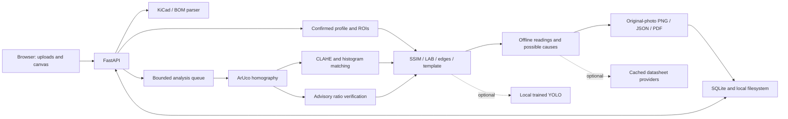

# Trace — PCB Missing-Component Detector

A local web app that compares a known-good PCB photo with a phone photo of a board under test. ArUco alignment removes holder perspective/scale differences; confirmed component boxes connect visual findings to schematic/BOM identities. It exports annotated PNGs, JSON findings and PDF reports.

FastAPI · Python 3.11 · OpenCV ArUco · NumPy / SSIM · SQLite · buildless HTML/JS canvas. No trained model, internet connection, Node build, or API key is needed to inspect a board.

## Quick start

On this Windows workspace, a Python 3.11 runtime and the required dependencies have been installed locally under `.tools/` (ignored by Git):

```powershell
.\scripts\start.ps1
```

Open **http://127.0.0.1:8000** and click **Try the sample board**. The real pipeline runs against the included six-part NE555 fixture and identifies **R2 and C1** as missing. Interactive API documentation: **http://127.0.0.1:8000/docs**.

For a fresh checkout with Python 3.11:

```powershell
py -3.11 -m venv .venv
.\.venv\Scripts\python.exe -m pip install -r requirements.txt
.\scripts\start.ps1
```

Linux/macOS:

```sh
python3.11 -m venv .venv
. .venv/bin/activate
pip install -r requirements.txt
python -m uvicorn backend.app.main:app --host 127.0.0.1 --port 8000
```

Docker:

```sh
cp .env.example .env
docker compose up --build
```

Docker publishes only to localhost. Its named `pcb-data` volume retains profiles, uploads and reports. `docker compose down` preserves it; `docker compose down -v` removes it. The default app is a local tool without authentication; do not expose it directly on a public interface.

## Create a board profile

### Simple three-upload comparison (default)

Click **Fill with sample files**, then **Compare images** to try the actual three-upload flow. **Download samples (ZIP)** downloads the same files for manual selection. They also live in the repository's `sample_uploads/` folder; `sample_uploads.zip` is ready to extract. Upload `01_correct_pcb.png`, `02_phone_missing_parts.png`, and `03_reference.kicad_sch` in that order. R2 and C1 were erased from the synthetic test image. `04_phone_correct_board.png` has no erased parts. Optional BOM, netlist, placement proposals, exact fixture boxes and marker-distance JSON are included. The self-contained KiCad sheet is a component reference, not a build-ready circuit or physical PCB layout. Rebuild the pack with `python -m scripts.prepare_samples`.

Upload the correct PCB photo, the phone photo, and your `.kicad_sch` file, then click **Compare images**. XML `.net` or BOM `.csv` also works for the reference. No board name or manual component map is needed for this mode. Both photos must show the same four holder tags, with the board fixed relative to them. Optional measured holder dimensions correct the top-down aspect ratio.

The app aligns the photos, highlights significant visual differences, and lists schematic parts for reference. Region labels `V1`, `V2`, etc. are **image regions, not schematic designators**. Results remain uncertain: a difference could be a missing/moved part, other damage, glare or a shadow. The report includes each region's normalized distances to the four markers and the marker-baseline ratios. It does not claim to verify electrical faults.

`.kicad_sch` coordinates describe a circuit drawing. They cannot supply physical part-to-ArUco distances. For exact named missing-part checks, choose **Advanced: identify parts by designator** and use the physical-location workflow below. A `.kicad_pcb` layout can propose physical positions but still needs registration with the photo/holder. The app never silently treats schematic drawing coordinates as PCB coordinates.

API: `POST /api/compare` with multipart `ideal`, `test`, `schematic`, optional `width_mm` / `height_mm`; poll the returned `analysis_id` through the existing analysis endpoints. PNG/JSON/PDF exports work in both modes. Simple comparisons are kept out of the reusable component-profile selector.

### Named component inspection (advanced)

1. Place the board in a repeatable holder with **DICT_4X4_50**, 10 mm markers: **0 top left, 1 top right, 2 bottom right, 3 bottom left**. Include each complete marker and its quiet white border in the photo.
2. Upload a known-good JPEG/PNG/HEIC image. EXIF orientation is honored. Limits: 20 MB per file, 24 megapixels per image (configurable).
3. Name the board; upload a `.kicad_sch`, KiCad XML `.net`, or BOM CSV. CSV headers: `Designator,Value,Footprint,MPN`. Only Designator is mandatory. Quoted designator lists such as `"R1,R2"` expand into individual parts. A `.net` supplies named connectivity; the schematic parser imports symbol properties and asks for a flattened XML netlist for nets or hierarchical/multi-unit designs.
4. A PDF/image schematic is stored only as a reference attachment. Supply a BOM CSV alongside it; no image-to-netlist inference occurs.
5. Under **Placement file & holder dimensions**, enter the measured horizontal and vertical distances **between marker centers**. Defaults match the sample, not an arbitrary holder. Optional `.kicad_pcb` or placement CSV `Ref,PosX,PosY` (millimeters, Cartesian Y up) proposes part centers. KiCad PCB Y is converted. Positions are centered in the holder; proposed body sizes are placeholders that need correction. Use exported CSV for KiCad `.pos` files.
6. On **Define components**, select a designator, then drag a tight box around the component body. Click a dashed contour suggestion to assign it, or redraw to replace a box. Verify every position and size, including imported proposals. Click **Save component map**. All BOM parts require a box; use a populated-only BOM for intentionally unpopulated footprints.
7. Reopen the saved profile for subsequent boards. Keep board location and orientation within the holder fixed. Fiducials align the holder; they cannot compensate for a board moved independently inside it.

## Run and review an inspection

Upload the test photo on **Inspect & report**, then click **Analyze board**. The job runs in a bounded worker queue; the page polls persisted queued/running/completed/failed states. Photos must contain all four marker IDs. The UI shows clear errors for unreadable images, missing markers, incomplete profiles and gross layout mismatch.

Red marks mean missing, green present (opt-in), amber uncertain, purple displaced. Toggle the canonical rectified view or original phone view. Original-image overlays use inverse-homography quadrilaterals; JSON also includes axis-aligned bounding rectangles. Original coordinates refer to the **EXIF-oriented, full-resolution decoded image**, available from the analysis source endpoint.

Expand a row for ranked possible causes and ideal measurement guidance. Every cause and reading carries provenance and confidence. These are deterministic generic rules; visual findings do not diagnose the physical cause, and electrical readings are not simulated. Resistance/capacitance comes from parsed nominal values; tolerance remains unspecified unless supplied. Generic IC readings deliberately do not invent supply node voltages or operating temperatures. Net names add context, not an inferred circuit simulation.

Download **PNG**, **JSON**, or **PDF**. Enable **Save debug images** before analysis (API `?debug=1`) to store rectified reference, normalized test and per-component diff heatmaps under `data/analyses/<id>/`. Ordinary runs retain the original, rectified and annotated output needed by the UI. JSON profiles also live under `data/boards/<id>/profile.json`; SQLite is authoritative.

## Architecture



## Configuration and calibration

Edit `config.yaml` and restart the server. `PCB_DATA_DIR` selects the storage directory via process environment. Direct Python launches do not read `.env` automatically; Docker Compose does. Feature flags live in YAML, not `.env`.

| Setting | Purpose |
| --- | --- |
| `geometry.*` | Pixels/mm, holder defaults, marker size, canonical frame bound, ratio-warning threshold |
| `images.*` | Upload/pixel limits, blur rejection, LAB CLAHE settings |
| `detection.weights` | SSIM 0.30, LAB color 0.20, edge density 0.15, template 0.35 |
| `detection.present_threshold` | Scores ≥ 0.76 classify as present |
| `detection.missing_threshold` | Scores ≤ 0.55 classify as missing; the gap stays uncertain |
| `detection.search_px` | Small template search window around expected location |
| `detection.displaced_*` | Larger search, minimum template match and offset for displacement |
| `detection.min_background_similarity` | Reject gross background/layout mismatch outside component boxes |
| `runtime.*` | Worker count and pending-job limit |
| `features.*` | Optional YOLO and datasheet flags, off by default |

Use confirmed present and absent examples from your actual camera/board to tune thresholds. Improve holder repeatability and tight body boxes before changing weights. Inspect debug heatmaps. Increase the uncertain band when false positives matter. Confidence values are heuristic scores, not calibrated probabilities. Cache keys include upload bytes, complete board profile, and configuration; changing a profile or config invalidates prior analysis cache entries. Optional datasheet cache is keyed by MPN.

## Tests and synthetic data

```powershell
.tools/python/python.exe -m pytest backend/tests -q
.tools/python/python.exe -m backend.vision.synthetic --output artifacts/synthetic --seed 19 --missing R2 C1
```

For a fresh environment substitute your venv Python. The generator creates a known-good marker board, BOM and ground-truth ROIs, then inpaints erased components before random scale/perspective/lighting changes. Tests cover homography, inverse mapping, ratio scaling, classifications, 50 seeded two-part erasures with no false positives in that distribution, displacement, parsers, rules, API lifecycle/cache/exports and optional fallback interfaces.

The development-only browser check uses your installed Chrome and `playwright-core` (no browser download):

```powershell
npm.cmd install --prefix .tools/browser playwright-core@1.51.1 --no-audit --no-fund
# Start the server in another terminal first.
node scripts/browser-check.cjs
```

Set `CHROME_PATH` if Chrome is elsewhere. This exercises demo analysis, view toggles, row details, PDF download, annotation editing, uploads and mobile layout. Screenshots go into ignored `artifacts/`. See [validation notes](docs/VALIDATION.md).

## Optional YOLO

The baseline does not import Torch or Ultralytics. To experiment in a separate environment, install `requirements-ml.txt` (review upstream licenses for your intended use), generate a dataset, and train your own model:

```sh
python -m backend.ml.generate_dataset --ideal fixtures/ne555/ideal.png --profile fixtures/ne555/components.json --output artifacts/training --count 200
yolo detect train model=yolov8n.pt data=artifacts/training/dataset.yaml epochs=50 imgsz=800 device=cpu
```

The training command may download initial weights. Set `features.yolo: true` and `yolo_weights` to your local trained `.pt` file. The detector fuses positive overlapping boxes with classical presence scores; no YOLO detection is never treated as proof of absence. Missing weights/dependencies fall back to classical detection with a report warning. The synthetic train/validation split uses different seeds of the **same board**, so its metrics do not establish performance on other boards. Real held-out images are essential. Training itself was not run for this delivery.

## Optional datasheet enrichment

Keep `features.datasheet_lookup: false` for offline operation. For opt-in lookup, `SearchProvider.search(mpn)` returns candidate HTTPS URLs; `Extractor.extract(mpn,text,schema)` supplies strict JSON facts. Implement a factory returning `(search, extractor)` and configure `features.datasheet_provider: your_module:factory`. The included `backend.knowledge.enrichment:http_providers` is a configurable HTTP adapter:

- `PCB_SEARCH_ENDPOINT` accepts `POST {"query":"..."}` and returns `{"results":[{"url":"https://..."}]}`. Adapt Tavily/SerpAPI/Bing to this contract; it is not their native wire format.
- `PCB_LLM_ENDPOINT` accepts OpenAI-compatible chat completions with `json_schema` response format. Set `PCB_LLM_MODEL`; optional bearer keys come from `PCB_SEARCH_API_KEY` / `PCB_LLM_API_KEY` process environment. No provider or paid key is bundled. Review provider cost and privacy before enabling.
- Source content is downloaded with size/time limits; redirects and non-public/non-HTTPS hosts are rejected. HTML text works with base requirements. Install `requirements-enrichment.txt` for PDF text extraction. Scanned PDFs without text need another extractor.
- Pydantic validates fields/ranges and exact MPN identity. MPN-hashed JSON caches preserve source URLs. Delete the corresponding `data/datasheets/` file to refresh. Any search, download, schema, or provider failure falls back to `source: rules` / `schematic-derived`. Enrichment reports operating ranges, not a guessed circuit voltage or normal measured surface temperature.

Provider contracts, cache and fallback behavior are tested with stubs; live providers and trained ML accuracy have not been verified.

## API

| Method | Path | Behavior |
| --- | --- | --- |
| POST | `/api/boards` | Multipart `ideal`, `schematic` and/or `bom`; optional `placement`, `name`, `width_mm`, `height_mm` |
| GET | `/api/boards` | Saved profile summaries |
| GET | `/api/boards/{id}` | Full profile, ROIs and ratios |
| PUT | `/api/boards/{id}/components` | JSON `{"components":[...]}`; confirms every designator |
| POST | `/api/boards/{id}/analyze?debug=1` | Multipart `test`; returns `analysis_id`, HTTP 202 |
| GET | `/api/analyses/{id}` | Status or full findings, structured error if failed |
| GET | `/api/analyses/{id}/source?rectified=true` | Normalized orientation original or canonical image |
| GET | `/api/analyses/{id}/image` | PNG; `rectified`, `show_present` booleans |
| GET | `/api/analyses/{id}/report?format=pdf` | PDF; `format=json` is the default |

Logs include JSON event records for completed/failed analyses; Uvicorn emits its standard access logs. Jobs interrupted by restart become failed and can be retried. Concurrent cache/queue admission is serialized with SQLite transactions.

## Limits

The app detects visual presence differences, not solder quality, wrong resistance values, invisible damage, short circuits, or component health. Reflections, occlusion, tiny components, extreme tilt, lens distortion, mismatched board revisions, altered silkscreen, intentional DNP parts and loose holder placement can produce uncertain or wrong results. Keep the same board side and revision; annotate only intended populated parts. Contour and placement proposals need confirmation. Strong layout mismatch can be rejected, but holder fiducials cannot identify the board itself. Ratios are scale-invariant, **not perspective-invariant**, and only reduce confidence when inconsistent.

The <5-second target was checked on the six-part synthetic fixture, not every board up to the 500-part configured limit. Live datasheet lookup, large phone image decoding/PNG encoding, and optional models may exceed it. Docker build verification requires a Docker installation, which was unavailable in this workspace.

See [ALGORITHM.md](docs/ALGORITHM.md), [DECISIONS.md](docs/DECISIONS.md), and [VALIDATION.md](docs/VALIDATION.md).
